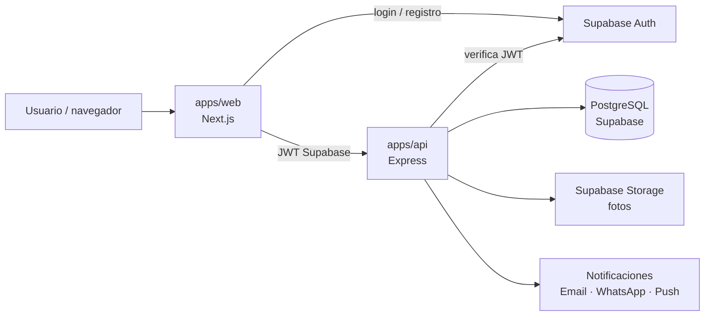
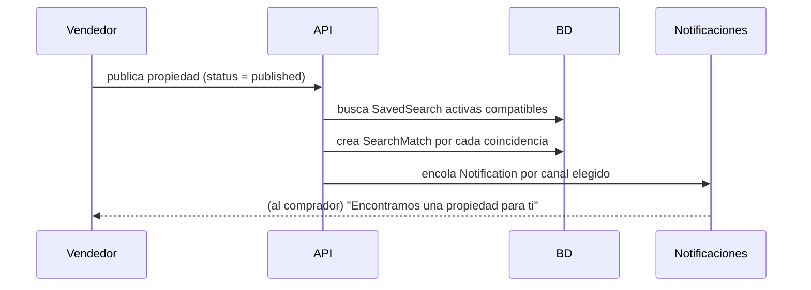

# Arquitectura de COSAVE

## Vista general

- **web**: UI. No tiene lógica de negocio; habla solo con el api.
- **api**: reglas de negocio, acceso a BD (Prisma), matching y notificaciones. Separado del web para que una app móvil futura use el mismo backend.
- **shared**: enums y esquemas zod usados por ambos (`@cosave/shared`).

## Autenticación
1. El usuario se registra/entra con Supabase Auth desde web.
2. Web envía `Authorization: Bearer <jwt>` al api.
3. `requireAuth` valida el JWT (JWKS de Supabase o `SUPABASE_JWT_SECRET`) y fija `req.user = { id, role }`.
4. `Profile.id` es el mismo uuid que `auth.users.id`; el api crea el perfil en el primer acceso (upsert en `requireAuth`). El **rol** se lee de la BD, no del token; `requireRole(...)` protege rutas de admin.

## Visitante vs. usuario registrado
Cualquiera explora sin cuenta (`/`, `/propiedades`). Al intentar **comprar o vender** (contactar, guardar búsqueda, favoritos, `/vender`) se exige cuenta:
- Enlaces a acciones protegidas usan `AuthLink`: sin sesión van a `/login?next=<destino>&volver=<página actual>` ("← Volver" regresa a `volver`).
- Páginas protegidas usan `RequireAuth`: sin sesión redirigen a `/login?next=<ruta>`.
- Tras entrar, se regresa a `next` (solo rutas internas, ver `safeNext`).
- **Acción pendiente**: si la acción es guardar un favorito, antes de ir al login se recuerda (`lib/pending-action.ts`, caduca en 15 min) y la URL lleva `motivo=favorito` para explicar por qué se pide la cuenta. `PendingActionRunner` (layout) la completa al haber sesión, si la propiedad sigue publicada, y la persona regresa a la pantalla donde estaba.
- **Búsqueda**: filtros, orden y texto viven en la query string de `/properties` (`?ciudad=merida&tipo=casa&precio_max=2000000`), así sobreviven a "atrás" y se pueden compartir. El texto libre se interpreta por palabras y precio (`lib/search.ts`).
- **Contacto**: "Me interesa" (ficha y cards) lleva a `/contacto/[code]`, que solo muestra el formulario con sesión; sin ella pasa por `/login?motivo=contacto` y regresa al formulario. Es un formulario con bandeja (no chat): cada envío crea una `Inquiry` `pending` ligada a la propiedad y al usuario. Si la propiedad no está `published` se bloquea el contacto nuevo (409 `unavailable`). Las consultas propias se ven en `/profile/[id]/pedidos` ("Mis consultas").
- **Publicar solo con cuenta real**: las propiedades viven en el api (`/me/properties`); las cuentas demo solo exploran. El catálogo público (portada, listado, mapa, ficha) lee del api y, si no responde, cae a los datos de ejemplo.
- **Favoritos y consultas, dos modos**: con cuenta real (Supabase) viven en el api y se ven desde cualquier dispositivo; los usuarios demo siguen en `localStorage`. La interfaz (`useFavorites`, `lib/inquiries.ts`) es la misma en ambos.
- El api es la barrera real: las rutas protegidas usan `requireAuth`; la UI solo guía.

## Flujo de coincidencias (el diferenciador)

Una `SavedSearch` coincide si: misma operación; tipo, ciudad/zona iguales (si se indicaron); precio dentro de rango; recámaras/baños ≥ mínimos. `SearchMatch` es único por (búsqueda, propiedad), así no se avisa dos veces.

## Flujos del README → módulos

| Flujo | Módulo api | Etapa |
|---|---|---|
| Comprador busca y filtra | `properties` (búsqueda) | 3 |
| Favoritos y contacto | `favorites` | 4 |
| "No encontré lo que busco" | `saved-searches` + `matching` | 5 |
| Vendedor publica / pide asesor / servicios | `properties`, `seller-requests` | 2 / 5 |
| Asesor: perfil y propiedades | `professionals` | 5 |
| Usuarios y admin | `users`, `admin` | 1 |

## Puertos y entorno
web `5300` · api `3300`. Variables en `.env.example`.
