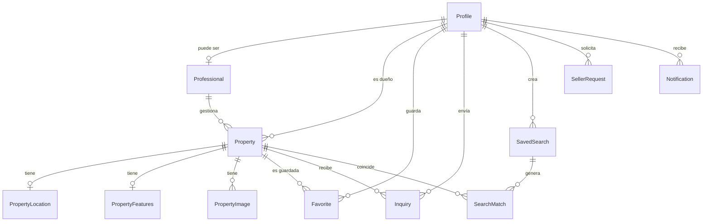

# Modelo de datos

Fuente de verdad: `apps/api/prisma/schema.prisma` (borrador de Fase 0, sin migrar hasta la Etapa 1).

| Tabla | Para qué sirve |
|---|---|
| **Profile** | Usuario (id = uuid de Supabase Auth), con teléfono y ciudad opcionales. Rol: comprador, vendedor, asesor, admin. |
| **Professional** | Datos extra del asesor inmobiliario (empresa, licencia, verificado). |
| **Property** | La propiedad: tipo, operación (venta/renta), estado, precio, `publicCode` (COS-000001). |
| **PropertyLocation** | Estado, ciudad, zona, dirección, código postal (5 dígitos, opcional), coordenadas (`latitude`/`longitude`, elegidas en el mapa al publicar). Separada para indexar búsquedas por ciudad. |
| **PropertyFeatures** | Recámaras, baños, estacionamientos, m² de terreno y construcción. |
| **PropertyImage** | Ruta en Supabase Storage y orden de cada foto. |
| **Favorite** | Usuario ↔ propiedad guardada (clave compuesta). |
| **Inquiry** | Consulta "Me interesa": propiedad, remitente, mensaje, datos de contacto compartidos y estado (`pending` hasta que el anunciante responda, luego `answered`). |
| **SavedSearch** | "No encontré lo que busco": criterios estructurados + canales de aviso (USER_REQUESTS del README). |
| **SearchMatch** | Coincidencia búsqueda ↔ propiedad; `notifiedAt` evita avisos duplicados. |
| **SellerRequest** | Vendedor pide publicar solo, buscar asesor o contratar servicios. |
| **Notification** | Aviso por email / WhatsApp / push con su estado de envío. |

## Índices clave
- `Property(status, operation, type, price)` — listado y filtros.
- `PropertyLocation(state, city)` — búsqueda por ubicación.
- `Inquiry(senderId, createdAt)` y `Inquiry(propertyId, createdAt)` — bandeja del remitente y del anunciante.
- `SavedSearch(active, operation, propertyType, city)` — matching al publicar.

## Notas
- Dinero en `Decimal(14,2)`, moneda por propiedad (`MXN` por defecto).
- Borrar un perfil/propiedad elimina en cascada favoritos, búsquedas, coincidencias e imágenes.
- `PropertyStatus`: `draft` (borrador), `pending` (en revisión), `published`, `paused`, `sold`, `rented`, `rejected` y `archived` (retirada). Solo `published` admite favoritos nuevos y consultas; los favoritos existentes se conservan y muestran por qué ya no está disponible.
- El estado **no se edita libremente**: las transiciones válidas y quién las hace viven en `packages/shared` (`allowedTransitions`) y las valida el api. Cada cambio queda en `PropertyStatusEvent` (de, a, quién, nota); nada se borra, solo se retira.
- `Property.reviewNote`: motivo de rechazo o aviso de posible duplicado. `submittedAt` / `publishedAt`: envío a revisión y primera publicación (ordena «últimos publicados»).
- Fotos: `PropertyImage.storagePath` es la ruta en el bucket público `property-images` de Supabase Storage (o una ruta del web, `/img/…`, en las de ejemplo). La principal es la de `position = 0`.
- Migraciones `20261012000000_codigo_postal_ubicacion`, `20261012010000_ciudad_perfil` y `20261012020000_publicar_propiedades`.
- `Favorite` tiene clave `(userId, propertyId)`: guardar dos veces no duplica.
- Los datos de contacto de `Inquiry` se copian del formulario (lo que la persona decidió compartir), no del perfil.
- Migración `20261009000000_favoritos_consultas`. Propiedades de ejemplo: `pnpm --filter @cosave/api db:seed`.
- `publicCode` (COS-000001) sale de la secuencia `property_code_seq`, que arranca en 1000 para no chocar con las 14 de ejemplo.
