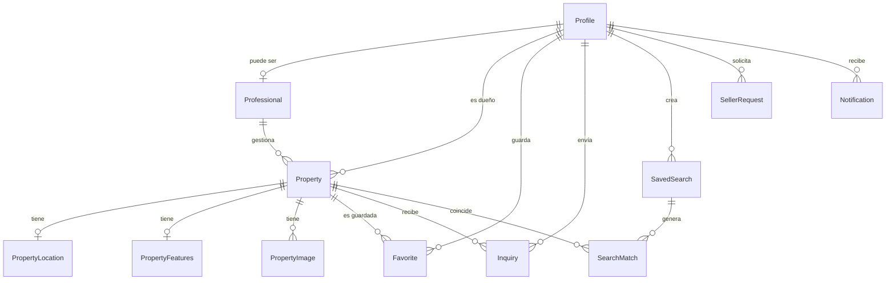

# Modelo de datos

Fuente de verdad: `apps/api/prisma/schema.prisma` (borrador de Fase 0, sin migrar hasta la Etapa 1).

| Tabla | Para qué sirve |
|---|---|
| **Profile** | Usuario (id = uuid de Supabase Auth), con teléfono y ciudad opcionales. Rol: comprador, vendedor, asesor, admin. |
| **Professional** | Datos extra del asesor inmobiliario (empresa, licencia, verificado). |
| **Property** | La propiedad: tipo, operación (venta/renta), estado, precio, `maintenanceFee` (cuota mensual de mantenimiento; solo departamentos y propiedades en privada, si deja de aplicar el api la borra), `publicCode` (COS-000001). |
| **PropertyLocation** | Estado, ciudad, zona, dirección, código postal (5 dígitos, opcional), coordenadas (`latitude`/`longitude`, elegidas en el mapa al publicar). Separada para indexar búsquedas por ciudad. |
| **PropertyFeatures** | Recámaras, baños, estacionamientos, m² de terreno y construcción. `amenities` (características: alberca, andén de carga…) y `materials` (materiales de construcción) son listas `text[]` con **claves** del catálogo `AMENITIES` / `MATERIALS` de `packages/shared`; el api solo acepta claves del catálogo y descarta las que no aplican al tipo de inmueble. |
| **PostalCode** | Catálogo de códigos postales de México (una fila por colonia: código, colonia, estado, municipio, ciudad y coordenadas aproximadas, que centran el mapa al escribir el código). Fuente: GeoNames (CC BY 4.0, se da crédito en el formulario). Se carga con `pnpm --filter @cosave/api db:postal-codes <MX.txt>` (descomprimir `https://download.geonames.org/export/zip/MX.zip`). Solo lectura para la app. |
| **PropertyImage** | Ruta en Supabase Storage y orden de cada foto. |
| **Favorite** | Usuario ↔ propiedad guardada (clave compuesta). |
| **Inquiry** | Consulta "Me interesa": propiedad, remitente, mensaje, datos de contacto compartidos y estado (`pending` hasta que el anunciante responda, luego `answered`). |
| **SavedSearch** | "No encontré lo que busco": criterios estructurados + canales de aviso (USER_REQUESTS del README). |
| **SearchMatch** | Coincidencia búsqueda ↔ propiedad; `notifiedAt` evita avisos duplicados. |
| **SellerRequest** | Vendedor pide publicar solo, buscar asesor o contratar servicios. |
| **Notification** | Aviso por email / WhatsApp / push con su estado de envío, o dentro de la app (`in_app`, campana del header) con `readAt` para saber si ya se leyó. |
| **AuditLog** | Bitácora de acciones importantes: quién (`actorId`), qué (`action`), sobre qué (`entityType` + `entityId`) y qué cambió (`before` / `after`, solo los campos relevantes). Solo admite inserciones. |

## Índices clave
- `Property(status, operation, type, price)` — listado y filtros.
- `PropertyLocation(state, city)` — búsqueda por ubicación.
- `Inquiry(senderId, createdAt)` y `Inquiry(propertyId, createdAt)` — bandeja del remitente y del anunciante.
- `SavedSearch(active, operation, propertyType, city)` — matching al publicar.
- `Notification(userId, channel, createdAt)` — campana: avisos de una persona, más recientes primero.
- `AuditLog(entityType, entityId, createdAt)`, `AuditLog(actorId, createdAt)` y `AuditLog(createdAt)` — historial de una entidad, de una persona y lo más reciente.

## Seguridad
- **RLS activado en todas las tablas de `public`, sin políticas** (migración `20261025020000_rls_tablas_publicas`). La API REST de Supabase (llave pública `anon` / `authenticated`) no puede leer ni escribir nada; todo pasa por `apps/api`, que se conecta como `postgres` (dueño de las tablas, con `BYPASSRLS`). El aviso "RLS Enabled No Policy" del linter de Supabase es intencional.
- **Toda tabla nueva debe activar RLS en su propia migración:** `ALTER TABLE "MiTabla" ENABLE ROW LEVEL SECURITY;` (Prisma no lo agrega solo). Comprobar después con el linter de seguridad de Supabase.

## Notas
- Dinero en `Decimal(14,2)`, moneda por propiedad (`MXN` por defecto).
- Borrar un perfil/propiedad elimina en cascada favoritos, búsquedas, coincidencias e imágenes.
- `PropertyStatus`: `draft` (borrador), `pending` (en revisión), `published`, `paused`, `sold`, `rented`, `rejected` y `archived` (retirada). Solo `published` admite favoritos nuevos y consultas; los favoritos existentes se conservan y muestran por qué ya no está disponible.
- El estado **no se edita libremente**: las transiciones válidas y quién las hace viven en `packages/shared` (`allowedTransitions`) y las valida el api. Cada cambio queda en `PropertyStatusEvent` (de, a, quién, nota); nada se borra, solo se retira.
- `Property.reviewNote`: motivo de rechazo o aviso de posible duplicado. `submittedAt` / `publishedAt`: envío a revisión y primera publicación (ordena «últimos publicados»).
- Fotos: `PropertyImage.storagePath` es la ruta en el bucket público `property-images` de Supabase Storage (o una ruta del web, `/img/…`, en las de ejemplo). La principal es la de `position = 0`.
- Migraciones `20261012000000_codigo_postal_ubicacion`, `20261012010000_ciudad_perfil` y `20261012020000_publicar_propiedades`.
- `PropertyType`: `house`, `apartment`, `land`, `commercial` (local comercial), `commercial_warehouse` (bodega comercial), `industrial_warehouse` (bodega industrial) y `other`. Las bodegas y las listas `amenities` / `materials` llegaron en `20261027000000_caracteristicas_materiales_bodegas` (solo agrega valores y columnas; no borra datos). `maintenanceFee` y `PostalCode` (con RLS) llegaron en `20261028000000_mantenimiento_codigos_postales`; las coordenadas del catálogo, en `20261028010000_coordenadas_codigos_postales`, y el índice `(state, municipality)` para el recuadro del municipio, en `20261028020000_indice_municipio_codigos_postales`.
- El código postal es obligatorio para enviar a revisión; estado y ciudad se toman del catálogo `PostalCode`, no se escriben a mano. La colonia se elige de la lista del código o se escribe («Otra») si es un fraccionamiento nuevo.
- `Favorite` tiene clave `(userId, propertyId)`: guardar dos veces no duplica.
- Los datos de contacto de `Inquiry` se copian del formulario (lo que la persona decidió compartir), no del perfil.
- Migración `20261009000000_favoritos_consultas`. Propiedades de ejemplo: `pnpm --filter @cosave/api db:seed`.
- **Coincidencias de búsquedas guardadas:** al aprobar una propiedad (`published`), el api la compara con las `SavedSearch` activas (`apps/api/src/lib/search-matching.ts`). Operación obligatoria; tipo, estado, municipio y zona solo si la búsqueda los pide (sin distinguir mayúsculas ni acentos); precio exacto, sin margen; recámaras y baños como mínimos. Por cada coincidencia nueva crea un `SearchMatch` (con `notifiedAt`) y una `Notification` `in_app`. Nunca avisa al dueño de la propiedad ni dos veces por la misma búsqueda y propiedad.
- Migración `20261025000000_notificaciones_in_app`: valor `in_app` en `NotificationChannel`, columna `Notification.readAt` e índice de la campana.
- **Auditoría (`AuditLog`):** registra `user.role_changed`, `property.reviewed`, `property.archived_by_admin`, `property.image_deleted` y `property.edited` (solo en propiedades publicadas o pausadas; editar un borrador no se registra). Se escribe en la misma transacción que el cambio (`apps/api/src/lib/audit.ts`). Los cambios de estado de propiedades siguen en `PropertyStatusEvent`. `actorId` no tiene relación con `Profile`, para que el registro sobreviva aunque se borre el perfil. Un trigger (`AuditLog_append_only`) rechaza cualquier `UPDATE` o `DELETE`. Lista y etiquetas en `packages/shared` (`AUDIT_ACTIONS`). Migración `20261025010000_auditoria`.
- `publicCode` (COS-000001) sale de la secuencia `property_code_seq`, que arranca en 1000 para no chocar con las 14 de ejemplo.
